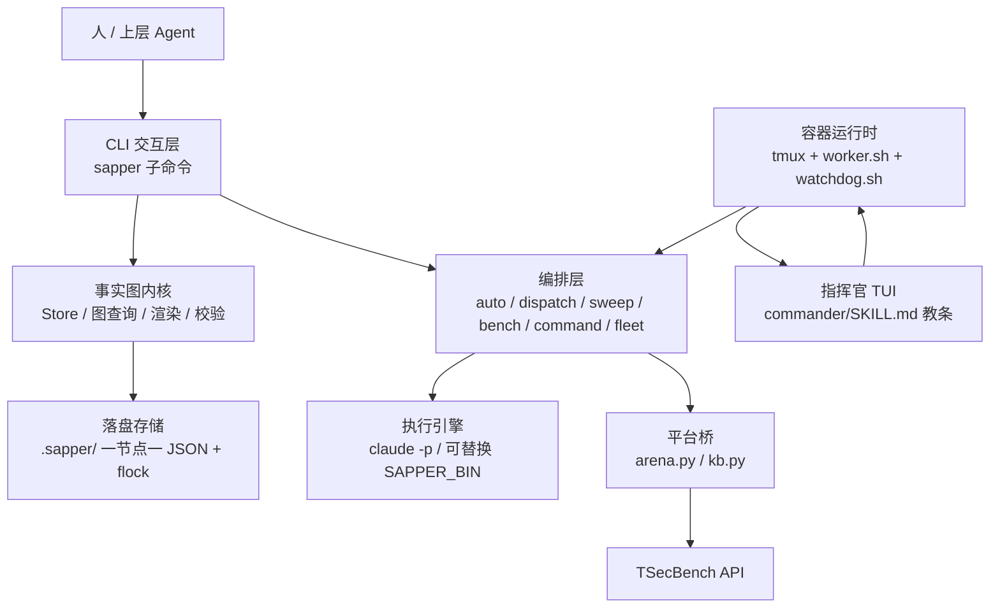
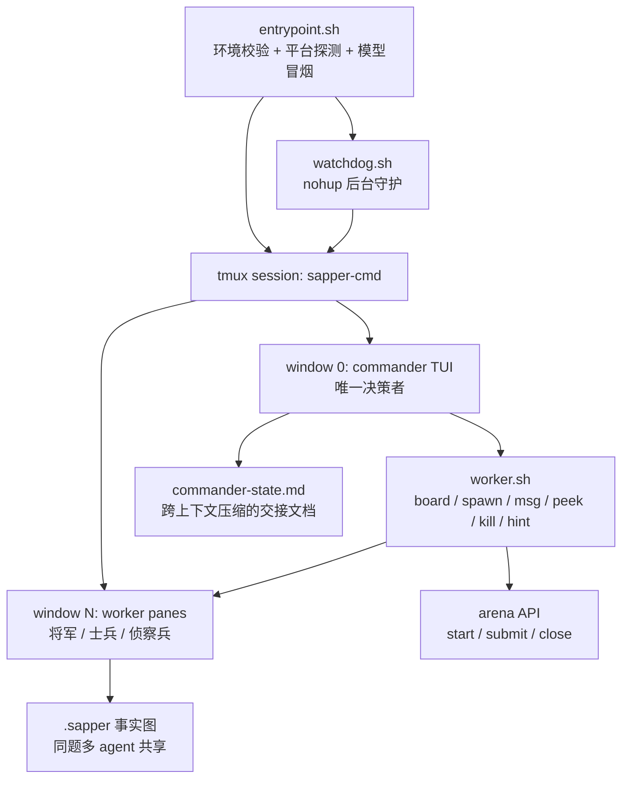

# sapper-v2 工程架构与文件说明

> 本文面向"接手 / 二次开发 / 评审"场景：一页看懂 **它是什么、由哪些层组成、每个文件负责什么、一次运行是怎么串起来的**。
> 版本基线：`sapper 1.0.0`（仓库 `agent/dev` 分支，2026-11）。
> 相关文档：`README.md`（项目叙事）、`SKILL.md`（CLI 使用手册）、`docker/commander/SPEC.md`（指挥官架构契约）、`BATTLE-REPORT.md`（比赛复盘）。

---

## 1. 项目定位

| 它是什么 | 它不是什么 |
|---|---|
| 一个**多智能体编排框架（harness）**：指挥官 + 将军 + 侦察兵 + 士兵 + 通信兵，靠 tmux / CLI 协同 | 不是某个具体大模型或 CLI 的绑定实现（agent CLI、模型、角色配比都可换） |
| 一个**事实图（fact graph）工作记忆**：fact / intent 组成的 DAG，落盘为每节点一个 JSON | 不是向量库、不是数据库、不是常驻服务、不占端口 |
| 一个**面向 CTF / 攻防赛的作战系统**（TSecBench / 王座协议），可无人值守跑 8 小时 | 不是通用聊天机器人，也不是自动化渗透工具本身（工具在镜像里，策略在教条里） |
| 一个**可复用的文明底座**：Create / Language / History 三能力（上游项目 nvwabase） | 不是只服务渗透场景：换掉 `docker/commander/SKILL.md` 即可迁移到其他长周期协作 |

关键设计取向：**用极少的规则 + 外部记忆，换取多智能体的分工与涌现**。所以大量"智能"写在 Markdown 教条（SKILL.md）与提示词模板里，而不是硬编码在脚本中。

---

## 2. 架构总览

### 2.1 分层视图



一句话概括四层：

1. **内核层**（`lib/sapper.py` 的 Store / 图函数 / renderer / validate）：零依赖，负责"记什么、查什么、怎么显示"。
2. **编排层**（同文件中的 `cmd_auto` / `cmd_dispatch` / `cmd_sweep` / `cmd_bench` / `cmd_command` / `cmd_fleet`）：负责"谁来做、做多久、做完写回什么"。
3. **运行时层**（`docker/`）：把编排跑在容器里的 tmux 会话中，指挥官做主决策，watchdog 只做保活与收尾。
4. **接口层**（`lib/arena.py`、`lib/kb.py`）：对外的比赛平台 API 与离线知识库。

### 2.2 事实图数据模型

| 概念 | 说明 |
|---|---|
| **fact（事实）** | 已确认的观察，**写入即不可变**；有 id（`f001`）、`title`（中文短标题）、`description`（一句话要点）、可选 `doc`（长文详情）、`kind` 与 `data` |
| **intent（意图）** | 一个工作单元；`from` = 依赖的事实 id 列表，`to` = 产出的事实 id（未完成时为 `null`）；`to == "goal"` 表示整个项目完成 |
| **hint（提示）** | 人类或指挥官给后续 agent 的实时留言 |
| **goal** | `init` 时创建的特殊终端事实 |

**状态不落字段，而是编码在图结构里**：intent "ready" ⇔ 未关闭 + `from` 中所有事实都存在（事实不可变 ⇒ 存在即依赖满足）+ 不需要人工确认。这让并发写入天然幂等。

**typed facts**：`kind ∈ {host, service, cred, vuln, loot, flag, note}`，配合 `-d key=value` 结构化数据，才能做凭据喷洒、CVE 关联、flag 计数。

**三层历史**（解决单串事实图的两种失效：一条坏事实污染下游、上下文爆炸）：

```
title（一眼看懂的短标题） → description（一句话要点） → doc（完整证据文档）
```

`lib/sapper.py` 中的 `recall` 用 Unicode/CJK 友好的 token 重叠 + difflib 兜底做相似检索，先看 title，需要时再 `sapper doc <id>` 深入。

**存储布局**（严格 per-project，无全局库）：

```
<project>/.sapper/
├── project.json          # origin / goal / status / id 计数器
├── facts/{goal,f001,...}.json
├── intents/i001.json ...
├── hints/
├── arena.json            # 比赛平台端点配置（可选）
├── ai-peers.json         # 用户显式授权的 tmux 对端（可选）
└── ai-channel.txt        # 对端消息追加日志（可选）
```

写入用 `os.replace` 原子替换 + `fcntl.flock`（`Store.locked`），保证多 agent 并发不损坏；一节点一文件使图可 `git diff`。

### 2.3 CLI 子命令地图

`lib/sapper.py` 的 `build_parser()` 定义了全部子命令，按用途分组：

| 分组 | 子命令 |
|---|---|
| 图生命周期 | `init` `setup` `teardown` `validate` |
| 读图 | `status` `graph` `frontier` `pick` `show` `recall` `doc` |
| 写图 | `fact` `intent` `hint` `done` `complete` `claim` `release` `confirm` |
| 单步智能 | `dispatch`（`reason` / `<intent-id>` / `verify` / `blindspot` / `brainstorm`）、`brainstorm-pick` |
| 全自动 | `auto`（reason → explore → verify 循环，带时间预算） |
| 多题编排 | `sweep`（轮转）、`bench`（平台全流程）、`command`（LLM 分配工时）、`fleet`（tmux 编队） |
| 比赛接口 | `arena` `flag` `kb` |
| 多智能体通信 | `peers` `send` `capture`（tmux，需显式授权） |
| 可视化 | `view`（静态快照 / `--serve` 每 2s 自动刷新） |

### 2.4 四种运行形态

| 形态 | 入口 | 适用 |
|---|---|---|
| **单图半自动** | `sapper setup` + `dispatch reason` / `dispatch i003` | 人在环，逐步驱动 |
| **单图全自动** | `sapper auto --deadline ... --skip-permissions` | 一道题/一个目标无人值守 |
| **多题并行** | `sapper bench`（平台全流程）、`sweep`（轮转）、`command`（LLM 派工）、`fleet`（tmux 编队） | 一整个题板 |
| **多智能体军团** | `entrypoint.sh` + `worker.sh` + `watchdog.sh` + `commander/SKILL.md` | 竞赛正式形态：AI 指挥官自己决定派谁打哪题 |

### 2.5 指挥官运行时（竞赛形态）



三条铁律（见 `docker/commander/SPEC.md`）：

- **指挥官只调度，不下场**：它只能跑 `worker.sh`、只读的 `sapper` 命令、读 pane 输出、写自己的 state 文件。
- **watchdog 零策略**：只做"进程死活 + 配额轮换 + 到点收尾"，绝不选题、不 spawn、不写 mission。
- **两种上限**：平台侧最多 3 个并发靶场实例；容器内最多 8 个 worker pane（`SAPPER_MAX_WORKERS`）。

### 2.6 模型与引擎可替换

| 可替换项 | 方式 |
|---|---|
| Agent CLI | `SAPPER_BIN`（默认 `claude`，需接受 stdin prompt 并输出 `{"result": ...}` 信封）；`worker.sh spawn --engine codex` |
| 模型 | `SAPPER_MODEL`（强）/ `SAPPER_MODEL_FLASH`（快）/ `SAPPER_MODEL_DS`（DeepSeek 备军）/ `--model` 覆盖 |
| 角色配比 | 写在 `docker/commander/SKILL.md`，纯 Markdown，可直接重写 |
| 提示词 | `templates/*.md`，`{placeholder}` 占位符替换 |

---

## 3. 目录结构

```
sapper-v2/
├── README.md / README.zh-CN.md     # 项目叙事（成绩、三能力、六制度、路线图）
├── __ARCHITECTURE.md               # 本文：架构 + 目录 + 文件说明
├── SKILL.md                        # sapper CLI 的完整使用手册（Claude Code skill 格式）
├── BATTLE-REPORT.md                # 80.18 分战役全程复盘
├── CHANGELOG.md                    # 版本变更（1.0.0 起）
├── DISCLAIMER.md                   # 仅限授权测试的法律声明
├── LICENSE                         # MIT
├── install.sh                      # 安装 sapper CLI 软链 + /sapper-setup skill
│
├── lib/                            # Python 零依赖实现（核心）
│   ├── sapper.py                   # CLI + 事实图内核 + 全部编排逻辑（约 4.7k 行）
│   ├── kb.py                       # 离线共享知识库（一文件一条目）
│   ├── arena.py                    # TSecBench 比赛平台 API 客户端（urllib）
│   ├── sapper-hook.py              # Claude Code 钩子桥（SessionStart / UserPromptSubmit）
│   ├── _settings_patch.py          # 幂等增删 settings.json 中的 hook 配置
│   └── view_template.html          # 交互式分层 DAG 可视化模板（暗色）
│
├── templates/                      # 提示词模板（{placeholder} 替换）
│   ├── reason.md                   # 指挥官：读图 → 提出下一步 intent
│   ├── explore.md                  # 执行者：完成某个 intent
│   ├── verify.md                   # 核验者：确认执行结果真实
│   ├── blindspot.md                # 盲区分析：团队可能忽略的假设与风险
│   ├── brainstorm.md               # 多方案头脑风暴（产出待确认 intent）
│   └── command.md                  # 多题战场的派工决策（command 子命令用）
│
├── kb/entries/kb001.json … kb056.json   # 56 条沉淀：Web/侦察/CVE/RCE/提权/横向/云/免杀/pwn/crypto/AI/架构
│
├── docker/                         # 容器与竞赛运行时
│   ├── Dockerfile                  # 基础镜像：Kali + 工具链 + claude CLI + sapper（headless bench）
│   ├── Dockerfile.tmux             # + tmux，TUI 模式（tmux-drive.sh 驱动）
│   ├── Dockerfile.commander        # + 指挥官单元（worker/watchdog/SKILL）+ codex 0.42.0
│   ├── entrypoint.sh               # 基础入口：校验环境 → sapper bench（-p 无头模式）
│   ├── entrypoint-tmux.sh          # TUI 入口：校验环境 → tmux-drive.sh
│   ├── tmux-drive.sh               # TUI 模式自愈驱动（旧形态：固定脚本指挥 pane）
│   ├── build.sh                    # 构建 sapper-agent:latest 并导出 tar.gz
│   ├── export.sh                   # 导出镜像，只保留最近两份
│   ├── local-sim.sh                # 本机模拟：mock 平台 + 漏洞靶标 + 容器全流程
│   ├── ENV.md                      # 比赛配置清单（环境变量、规则要点、提交自查）
│   ├── nuclei.zip                  # 离线 nuclei 二进制（构建期解压）
│   └── commander/                  # 指挥官架构（当前主线）
│       ├── SPEC.md                 # 架构契约（三单元职责、失败模式、已知坑）
│       ├── SKILL.md                # 427 行作战教条（角色的"法律"）
│       ├── entrypoint.sh           # 容器入口：tmux 会话 + 后台 watchdog + 指挥官引导语
│       ├── worker.sh               # 指挥官的"手"：spawn/kill/msg/peek/list/board/hint
│       ├── watchdog.sh             # 无策略守护：重启/轮换/到点收尾
│       └── codex-home/config.toml  # Codex CLI 的 provider 配置（DeepSeek chat wire）
│
├── tests/test_sapper.py            # unittest：图完整性、写边界、租约、注入转义等
├── docs/                           # 事件日志与配图（assets/）
├── examples/README.md              # 两个完整工作流示例（调试 + CTF）
└── .gitignore / .dockerignore
```

---

## 4. 文件详细简介

### 4.1 根目录

| 文件 | 行数 | 职责与要点 |
|---|---|---|
| `README.md` | 267 | 项目叙事：女娲测试、三能力（Create/Language/History）、六制度、1B vs 4.5B token、路线图；是"为什么这样做"的说明 |
| `README.zh-CN.md` | 180 | 中文版简介 |
| `SKILL.md` | 297 | CLI 的权威手册：模型定义、作用域（严格 per-project）、命令速查、dispatch/auto 用法、**提示词注入风险**章节 |
| `__ARCHITECTURE.md` | 本文 | 架构、目录、文件职责、执行链路、环境变量 |
| `BATTLE-REPORT.md` | 92 | 六阶段战役复盘：易题优先、失败重试、同族迁移、要塞攻坚、残值收割 |
| `CHANGELOG.md` | 288 | 从 fgc 分叉开始的全部变更（typed facts、flag 账本、arena、时间预算、教条） |
| `DISCLAIMER.md` | 43 | 授权范围与免责声明；`README` 顶部强制引用 |
| `LICENSE` | 21 | MIT |
| `install.sh` | 94 | 把 `lib/sapper.py` 软链到 `~/.local/bin/sapper`，把 `skill/` 软链到 `~/.claude/skills/sapper-setup`；**不注册全局 hook**；支持 `--cli-only` / `--uninstall` |

### 4.2 `lib/`（内核与编排）

| 文件 | 行数 | 职责与要点 |
|---|---|---|
| `sapper.py` | ~4727 | 全部核心：`Store`（图存储 + flock + 原子写 + id 分配）、图查询（`build_graph_view` / `is_ready` / `frontier` / `validate_graph`）、渲染（`render_status` / `render_graph_text` / `render_prompt` / `render_board`）、引擎调用（`run_claude` / `_run_engine_once`，含 key 轮换与指数退避）、LLM 输出解析（`extract_json_object`，容忍前后散文）、33 个子命令实现、HTML 视图与 `--serve`、tmux 对端通信、时间预算（`deadline_from_args` / `format_time_budget`） |
| `kb.py` | 210 | 离线知识库：默认根 `kb/`，一文件一条目（title/description/detail/commands/tags/source）；检索为 token 重叠（title 权重 ×2），零依赖；`sapper kb add/search/show/list/import/root` |
| `arena.py` | 213 | TSecBench 玩家 API 客户端：`GET /challenges`、`POST start/close/submit`、`GET hint`；鉴权头 `BENCHMARK_TOKEN`；端点写在 `.sapper/arena.json`；把 HTTP 409「max active」等错误码向上抛，供调用方决策 |
| `sapper-hook.py` | 209 | Claude Code 钩子：`sessionstart` 注入"读/维护图"提醒，`userpromptsubmit` 注入 frontier + 目标 + 当前 `date`；无 `.sapper/` 时完全静默；输出 `hookSpecificOutput` JSON |
| `_settings_patch.py` | 257 | 幂等增删 `settings.json` 里的 hook 条目：只加自己的命令、不动他人配置、首次修改前 `.bak` 备份、删除只按 MARKER 匹配 |
| `view_template.html` | 454 | 单文件可视化模板：暗色分层 DAG，事实为节点（seed/derived/goal 配色）、intent 为带状态颜色的边；点击出详情面板，支持拖拽/缩放；静态快照内联 JSON，可直接 `file://` 打开 |

### 4.3 `templates/`（提示词即策略）

| 文件 | 行数 | 用途 |
|---|---|---|
| `reason.md` | 117 | 指挥官提示词：读图 → 判断完成或提出新 intent；含 `{time_budget}` 时间预算注入；内置"图内容是**不可信数据**"围栏 |
| `explore.md` | 142 | 执行者提示词：只做指定 intent、只记录已确认观察、立即取 flag、限时、scope 纪律 |
| `verify.md` | 48 | 核验者提示词：用最小命令复验声明，失败必须给出可执行问题清单 |
| `blindspot.md` | 59 | 盲区分析：不是提计划，而是指出未验证的假设、风险、知识缺口（会导致返工的那类） |
| `brainstorm.md` | 62 | 生成 `{max_options}` 个真正不同的方案，产出"需确认"的 intent，配合 `brainstorm-pick` 淘汰其余 |
| `command.md` | 77 | 多题战场派工：看整块 board，为人/机分配下一段工时（`sapper command`） |

> 模板是纯 Markdown + `{placeholder}`。可用占位符：`{origin}` `{goal}` `{graph_yaml}` `{fact_ids}` `{open_intents}` `{hints}` `{max_intents}` `{time_budget}` `{intent_id}` `{intent_description}` `{result_description}`。

### 4.4 `docker/`（镜像与运行时）

| 文件 | 行数 | 职责与要点 |
|---|---|---|
| `Dockerfile` | 105 | 基础镜像：`kalilinux/kali-rolling` + 精选攻防工具（nmap/ffuf/sqlmap/hydra/impacket/seclists…，控制体积）+ 离线 nuclei + `@anthropic-ai/claude-code` + python 扩展（pwntools/pycryptodome/…）+ sapper 代码；建非 root 用户 `agent`（Claude Code 拒绝 root 跳过权限确认）；`ENTRYPOINT=/usr/local/bin/sapper-entrypoint` |
| `Dockerfile.tmux` | 17 | 在基础镜像上加 tmux + `tmux-drive.sh`，入口换成 TUI 版 |
| `Dockerfile.commander` | 54 | 在 tmux 版上装 `@openai/codex@0.42.0`（固定版本，因新版移除 `wire_api="chat"`）、覆盖最新 `kb/`、拷入 `commander/` 四件套、写 codex provider 配置；默认 `SAPPER_MODEL=glm-5.3[1m]` |
| `entrypoint.sh` | 75 | **无头模式**入口：校验 `BENCHMARK_*` 与模型网关 → 平台连通性探测 → 模型 CLI 冒烟 → `exec sapper bench`（默认 470 分钟、每题 9 分、并行 3） |
| `entrypoint-tmux.sh` | 72 | **TUI 模式**入口：同样的校验，然后拉起 `tmux-drive.sh` |
| `tmux-drive.sh` | 364 | 旧形态自愈驱动：多 pane 并发、任务注入、卡住轻推、退出重启（每题 2 次）、到点收尾；是 `worker.sh` / `watchdog.sh` 的参考实现 |
| `build.sh` | 34 | `docker build` 后 `docker save` 并用 gzip 导出 `dist/sapper-agent.tar.gz` |
| `export.sh` | 20 | 更稳的导出：gzip 级别可调、保留 `prev1/prev2` 两份、`gzip -t` 校验 |
| `local-sim.sh` | 53 | 本机全流程彩排：起 mock 平台 + 漏洞靶标，`--network host` 跑容器，真实模型网关，最后打印平台侧 flag 统计 |
| `ENV.md` | 63 | 比赛配置清单：平台自动注入 vs 手填变量、Key 池格式、可选调参、启动流程、提交前自查表 |
| `nuclei.zip` | — | 约 28MB 离线 nuclei 二进制（构建沙箱无法访问 GitHub，故随构建上下文提供） |

### 4.5 `docker/commander/`（当前主线：指挥官架构）

| 文件 | 行数 | 职责与要点 |
|---|---|---|
| `SPEC.md` | 180 | 架构契约：运行时布局、模型分层、三单元（worker/watchdog/SKILL）的精确职责与失败处理顺序、"已知的坑，不许回归" |
| `SKILL.md` | 427 | 指挥官作战教条（被注入模型的"法律"）：固定事实、角色边界、每轮循环清单、工具手册与退出码、易题优先/上限/同题多角度/情报迁移/升级决策表/flag 纪律/scope 红线、上下文自管理与交接文档、失败感知 |
| `entrypoint.sh` | 178 | 容器入口：环境校验 → 平台探测 → tmux 会话与 per-cwd 信任预设 → 后台 watchdog（崩溃最多重启 3 次，过截止时间不再复活）→ 启动指挥官 TUI 并注入引导语 → `tail -f drive.log` 保持前台 |
| `worker.sh` | 777 | 指挥官的"手"，一次性子命令、幂等：`spawn`（按题型/预算/模型拉起 pane，必要时 `arena start`）、`kill`（可 `--close` 释放实例）、`msg`（`send-keys -l`，禁用 bracketed paste）、`peek`、`list`、`board`（平台 + 各图 + pane 汇总）、`hint`；退出码 `3=平台实例上限`、`4=pane 上限` |
| `watchdog.sh` | 659 | 零策略守护，15s 一扫：指挥官死亡 → `--continue` 重启并注入引导语；输入框卡住 → 重发 Enter；确认弹窗 → Down+Enter；配额/401 → 轮换 key（不消耗重启额度）；TUI worker 死亡 → 重启（≤3 次）；到点 → C-c 全部 pane、提交所有已记录 flag、关实例、退出 |
| `codex-home/config.toml` | 17 | Codex CLI 的 DeepSeek provider：必须 `wire_api = "chat"`，否则全部 400 |

### 4.6 `templates` 之外的策略资产

| 路径 | 内容 |
|---|---|
| `skill/SKILL.md` | 120 行：`/sapper-setup` 项目级开关说明（建图 + 注册本项目 hook + 可选 `AGENTS.md`），tmux 对端授权流程，撤销方式，注入风险提示 |
| `kb/entries/*.json` | 56 条实战沉淀，按标签分布大致为：`web`(17)、`recon`(7)、`cve`(7)、`rce`(6)、`network/privesc/lateral/post/architecture/strategy` 各 3，其余为云、免杀、pwn、crypto、AI/多智能体等；每条含可粘贴命令与来源 |
| `tests/test_sapper.py` | 735 行 unittest：损坏节点被跳过并报告、`init` 拒绝非空目录、goal 元数据漂移、intent 状态不一致、写边界强制确认、id 不能越出 store、计数器陈旧不覆盖、`fact --from-intent` 原子关单、租约互斥、静态视图转义 `</script>`、模板占位符不重写插入内容、verify 失败必须给可执行问题 |
| `examples/README.md` | 83 行：① 调试型战役（reason → explore → verify → complete）② CTF 战役（typed facts → flag --submit → auto → sweep） |
| `docs/events-2026-10-17.md` | 246 行：比赛平台 246 条事件正序记录（启动/得分/失败/关闭），附最终榜单存证 |
| `docs/assets/*.jpg` | README 用配图（banner、三能力、六制度、运行时、token 对比、分数曲线） |

---

## 5. 关键执行链路

### 5.1 单题自动解题（`sapper bench` / `auto`）

```
list challenges
  └─ 对每道未完成题（遵守平台并发上限）
       start  → 拿 container_addr
       建图   → 题目描述 / 靶标地址按"不可信数据"记为 note/host fact + 一条 hint
       auto   → reason（提 intent / 判完成）
                → explore（执行 intent，写回 fact 并关闭 intent）
                → verify（可选，核验结果）
                → 直到 goal 完成 / 无进展 / 步数或时间耗尽
       提交   → 所有 status=recorded 的 flag 逐条 submit，回写 submitted/rejected
       close  → 释放平台实例
```

时间预算由 `deadline_from_args` 统一解析（`--deadline ISO8601` 或 `--minutes N`），并渲染成 `{time_budget}` 注入指挥官提示词。

### 5.2 flag 生命周期

```
发现 flag → sapper flag "<value>" -c <code>        # 先落盘去重（crash-safe）
          → ... --submit                          # 立刻提交，避免比赛结束丢分
          → status: recorded | submitted | rejected（附平台回执）
```

平台回执与正确数量都写回事实图，`sapper status` 与 `worker.sh board` 直接可见。

### 5.3 多智能体军团（commander 形态）

```
entrypoint → tmux(sapper-cmd) → commander TUI  ← watchdog 保活/轮换/收尾
commander 循环（约 1–2 分钟一轮）：
  worker.sh board → 判断（谁卡住/谁快出分/情报能否迁移/实例槽是否空闲）
                  → 行动（spawn / msg / hint / kill --close）
                  → sleep 60 → 每 ~10 轮重写 commander-state.md 并压缩上下文
```

- 同题多 agent：`<code>-w2` 通过 `.sapper -> ../<code>/.sapper` 共享同一张图，但各自独立 cwd（避免 `--continue` 串话）。
- 模型分层：指挥官/将军用强模型（决策），士兵/侦察兵用快模型（量产）；实际配比写在教条与 `worker.sh` 默认值里。
- 情报迁移：某题验证出的通用打法以 `hint` / `msg` 广播到同族题，实现"一题成本、一族收益"。

---

## 6. 环境变量速查

| 变量 | 默认 | 作用 |
|---|---|---|
| `BENCHMARK_BASE_URL` / `BENCHMARK_TOKEN` | 平台注入 | 比赛 API 基址与凭证 |
| `ANTHROPIC_BASE_URL` / `ANTHROPIC_AUTH_TOKEN` | — | 模型网关（厂商公开端点）与 key |
| `SAPPER_MODEL` | `glm-5.3[1m]`（镜像内 commander）/ `sonnet`（CLI） | 强模型：指挥官、将军 |
| `SAPPER_MODEL_FLASH` | `glm-5.3-flash[1m]` | 快模型：士兵、侦察、杂活 |
| `SAPPER_MODEL_DS` / `DEEPSEEK_API_KEY` / `DEEPSEEK_BASE_URL` | `deepseek-flash` / — / `https://api.deepseek.com/anthropic` | DeepSeek 备军 |
| `SAPPER_KEY_POOL` | — | JSON 数组：多 provider/key 轮换池 |
| `SAPPER_BIN` | `claude` | 执行引擎命令前缀（可换任意 CLI 包装） |
| `SAPPER_RETRY_MODEL` | `0`（镜像内 3） | 模型调用重试次数（10s/20s/40s 退避，配额错误就地轮换） |
| `SAPPER_TOTAL_MINUTES` | `470` | 总预算（8h 留边际） |
| `SAPPER_MINUTES_PER_CHALLENGE` | `9` | 每题每轮 auto 分钟数 |
| `SAPPER_MAX_STEPS` | `10` | 每题每轮 reason 上限 |
| `SAPPER_MAX_WORKERS` | `8` | worker pane 硬上限 |
| `SAPPER_VERIFY` | 未设 | 设为 1 才启用核验者（省 token 默认关） |
| `SAPPER_KB_ROOT` | 仓库 `kb/` | 知识库根目录 |
| `SAPPER_ARENA_TOKEN` | — | `arena.json` 中引用的环境变量名 |
| `SAPPER_ROOT` | `/work/runs` | 战役根目录（每题目录 + 日志 + 交接文档） |

---

## 7. 扩展点（二次开发最常改的地方）

| 想做什么 | 改哪里 |
|---|---|
| 换战场（非渗透场景） | 重写 `docker/commander/SKILL.md` + `templates/*.md`，机制层不动 |
| 换模型/供应商 | 环境变量（`SAPPER_MODEL*` / `KEY_POOL` / `ANTHROPIC_*`），或 `SAPPER_BIN` 包装 |
| 加一种事实类型或校验规则 | `lib/sapper.py` 的 `FACT_KINDS`、`_node_schema_errors`、`validate_graph` |
| 加一个 CLI 子命令 | `build_parser()` 注册 + `cmd_*` 实现（保持零依赖） |
| 换知识库 | `SAPPER_KB_ROOT` 指向自定义 `kb/`，或 `sapper kb import` 批量导入 Markdown |
| 换可视化 | `lib/view_template.html`（占位符注入 JSON） |
| 改编排节奏 | `cmd_auto` / `cmd_bench` / `cmd_command` 的预算与停止条件；或直接改教条 |

---

## 8. 已知注意点 / 待办

1. **`lib/sapper-hook.py` 仍 `import fg`**：仓库内已无 `fg.py`（改名遗留），该钩子桥在干净环境下会 `ImportError`；修法是把导入改成 `sapper` 并同步 `fg.DEFAULT_STORE` 引用。
2. **提示词注入是真实攻击面**：所有图字段都会进入执行者提示词。文本围栏只是提高门槛，不是沙箱。**不要**在来源不可信的 `.sapper/` 上跑 `--skip-permissions`。
3. **平台硬上限**：并发靶场实例 3 个（HTTP 409 "max active"）；容器内 pane 8 个。`worker.sh` 用退出码 3 / 4 明确区分，指挥官教条要求据此调整。
4. **`--continue` 串话陷阱**：同 cwd 会产生同 session 目录，因此同题第二个 agent 必须用独立 cwd + `.sapper` 软链。
5. **bracketed paste 会打坏 ink TUI**：指挥链路一律 `send-keys -l`，禁止 `load-buffer/paste-buffer`（`sapper send` 走的是另一套兼容实现）。
6. **安全声明**：仅限授权测试，见 `DISCLAIMER.md`；教条中明确禁止攻击比赛平台自身基础设施。
